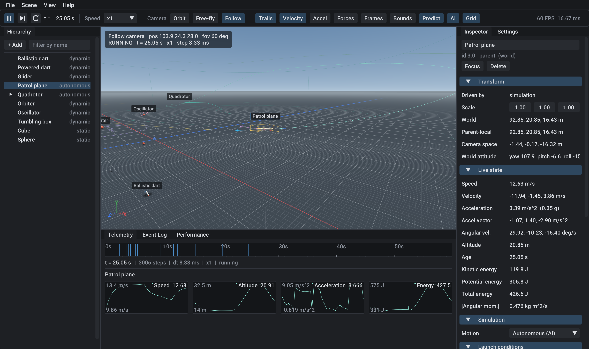

# AeroLab

> **A fully vibe-coded game engine and simulation playground.** Every line
> was written by an AI coding assistant (Claude Code) from my prompts. I use
> it to teach myself the serious math behind projectile and flight
> simulation: rigid-body dynamics, numerical integration and its errors,
> quaternion rotation, drag, lift and ballistic arcs, orbital motion,
> coordinate frames, steering behaviours, and how a real-time engine is put
> together. These are the same fundamentals that professional aerospace and
> defense-grade simulations are built on, explored here with generic objects:
> simple teaching models, plus a coefficient-based 6-DOF flight model of a
> generic hobby-scale quadrotor and trainer airplane.

AeroLab is a small, purpose-built **3D simulation engine and editor** for
learning the mathematics, physics, graphics programming and software
architecture behind fast-moving aerial objects. It is written from the
ground up in C++20 on SDL3, OpenGL 3.3 and Dear ImGui, with its own math
library and a GoogleTest suite.

It is an educational sandbox. Every object is a generic rigid body, a
scripted path or a self-flying "game AI" agent driven by configurable
models, from toy drag and lift to a full flight model: balls, boxes, model
darts, a glider, a quadrotor, a small trainer plane, springs, orbits.
Agents only fly to points they pick themselves and only ever steer away
from other objects; there is no guidance, targeting or interception logic
anywhere in the code base.



## Features

**3D viewport (the centrepiece)**
* Perspective camera with **orbit**, **free-fly**, **follow** and
  **first person** modes, frame-rate independent movement, smooth focus,
  exponential zoom and pixel-accurate panning.
* **First person on the ground:** place an *Observer* (Scene > Spawn >
  Observer, or key 4 / the *First person* button when none exists yet)
  where you are looking and see the scene through its eyes at 1.65 m. Key
  4 returns to the selected or last-used observer. In first person WASD
  walks, Shift runs, Ctrl creeps, right-drag looks, the wheel sets walking
  speed (shown in the HUD) and F turns to face the selection. You cannot
  walk through objects, and the figure walks with you, so other camera
  modes show where you are standing; moving the figure in the inspector
  moves you.
* Gradient sky with a visible horizon, an analytically anti-aliased infinite
  world grid with X/Z axis lines, directional sun with Blinn-Phong materials
  and hemispheric ambient light, distance fog, blob shadows, 4x MSAA.
* Procedural meshes: primitives plus generic dart, fixed-wing, quadrotor
  (with spinning rotor children) models.
* Debug layers, each switchable: motion trails, velocity, acceleration and
  per-term force arrows, local coordinate frames, oriented bounding boxes,
  drop lines to the ground, spring/attractor markers and a look-ahead of the
  selected body, plus a corner axis gizmo, object labels and a HUD.
* Click to select, hover highlighting, F to focus.

**Simulation**
* Fixed-timestep loop (default 120 Hz) with render interpolation: results
  are bit-identical at any frame rate.
* Rigid bodies with mass and principal inertia; Euler's equations for
  rotation; orientation integrated with the quaternion exponential map.
* Composable force model: gravity, linear and quadratic drag (with wind),
  timed thrust, simple wing lift, spring-damper, inverse-square attractor,
  weathervane torque, angular damping, body torque.
* Four integrators to compare: explicit Euler, semi-implicit Euler,
  velocity Verlet, RK4. An *integrator comparison* scene launches four
  identical orbits and plots their energy drift.
* Kinematic paths (circle, figure-eight, helix) with analytic derivatives.
* Ground contact with restitution and Coulomb friction; events for thrust
  burnout, impacts and numerical divergence.
* Play, pause, single step, reset and a 0.05x to 16x time scale.

**Autonomous flight (game AI)**
* The demo's quadrotor and patrol plane fly themselves; any object can be
  switched to *Autonomous (AI)* in the inspector or spawned with the *AI
  hover flight* / *AI wing flight* presets.
* Each agent runs sense -> decide -> steer -> move every fixed step: a small
  state machine (transit, loiter) picks destinations inside its flight area
  by scoring random candidates (leg length, turn needed, clear line of
  flight, novelty), chooses a cruise speed per leg, and hovers or circles
  for a while on arrival.
* Steering behaviours: arrive, meander (filtered random turning), stay in
  area, altitude band, and ray-cast obstacle avoidance ("context steering":
  fly the smallest clear deviation). Feelers work in each obstacle's moving
  frame, so agents anticipate other moving objects; wings also check the
  arc they are turning on, and anything too close pushes the agent away.
  An agent whose destination becomes occupied picks another one.
* Two flight models per agent (inspector *Flight model*):
  * **Physical** (the default for scene agents): the AI only decides what
    velocity it wants; an autopilot flies a real airframe there by moving
    its actuators, and forces and moments do the rest (see *Flight
    physics* below).
  * **Simple**: an idealized point mass within a hover envelope (stops,
    tilts to accelerate, jerk-limited) or a wing envelope (minimum
    airspeed, bank-limited turns with a roll-rate limit, climb and
    path-angle limits).
* Deterministic: a seeded generator means the same seed gives the same
  flight, and the look-ahead line replays the agent's own future
  decisions (with the physical model, its airframe and autopilot too),
  exactly as long as nothing else changes course.
* Inspector *Autopilot* section: what it is doing, its destination, leg
  speed and timers, what it is keeping clear of, plus its main tuning knobs.
  The *AI* toolbar toggle draws destinations, the flight area, the
  steering request and the object being avoided.

**Flight physics (physical flight model)**
* International Standard Atmosphere (troposphere and lower stratosphere):
  density, pressure, temperature and speed of sound with altitude; thrust
  and aerodynamic forces scale with the local air density.
* Fixed wing (a generic 2 kg, 1.8 m span trainer): angle of attack and
  sideslip from the airflow (wind included); lift linear in angle of
  attack, blending into flat-plate behaviour past a 14 degree stall;
  parabolic drag polar (parasite plus induced drag); side force; static
  stability and damping derivatives in pitch, roll and yaw (weathervane,
  dihedral effect, roll and pitch damping); elevator, ailerons and rudder;
  a propeller whose thrust fades with airspeed; throttle lag and
  rate-limited servos. Trims near 14 m/s, stalls near 8 m/s and glides at
  about 10:1.
* Multirotor (a generic 1.2 kg X-layout quadrotor): four rotors with
  thrust k_T w^2 and reaction torque k_Q w^2, alternating spin directions,
  first-order motor lag, linear and quadratic body drag against the air,
  and a mixer that inverts the thrust/torque allocation and gives up yaw
  before attitude when the motors saturate.
* Full 6-DOF rigid-body dynamics (Euler's equations with gyroscopic
  coupling) integrated with RK4, sub-stepped to at most 1/120 s.
* Autopilots modelled on real flight-controller structure: the quadrotor
  runs a cascade (velocity -> acceleration -> thrust vector -> attitude ->
  body rates -> torques -> rotor speeds); the airplane flies course with
  coordinated banked turns, climb rate with pitch, airspeed with throttle,
  rudder against sideslip, with stall protection (a speed floor 30% above
  the stall, a bank cap that keeps turns clear of it, and an
  angle-of-attack limit that flies a stalled wing out of the stall) and
  simple energy management (overspeed eases a descent; climb-rate changes
  are eased in). The quadrotor scales its rotor demands for thin air, and
  the airplane's speed floor rises with altitude as its stall speed does.
* Inspector *Airframe* section: airspeed, air density, stall speed, angle
  of attack, sideslip, bank and pitch, throttle and thrust, surface
  deflections, rotor speeds and thrust-to-weight. Physical agents also
  get a *Wind* setting in their autopilot settings. In wind, wings plan
  their turns for the faster downwind ground speed, so their legs run
  faster over the ground than the cruise range.

**Editor**
* Docking layout: viewport centre, scene hierarchy left, inspector and
  settings right, telemetry / event log / performance at the bottom,
  toolbar on top.
* Inspector shows a body's position in **world, parent-local and camera
  space**, live velocity/acceleration/energy/angular momentum, and edits
  launch conditions, mass and inertia, every force term, paths, ground
  contact, trails and materials.
* Telemetry: simulation timeline with event markers and speed / altitude /
  acceleration / energy plots.
* Performance: FPS, frame-time graph, CPU timings per stage, GPU time
  (timer queries), draw calls, triangles, steps per frame.

## Building

Requirements: CMake 3.25+, Ninja and a C++20 compiler (tested with
llvm-mingw Clang 22 on Windows; GCC/Clang on Linux and MSVC should work).
SDL3, Dear ImGui and GoogleTest are downloaded automatically by CMake and
verified against pinned SHA-256 hashes.

```sh
cmake --preset release            # or: debug
cmake --build --preset release
./build/release/bin/aerolab
```

Run the tests (unit tests, a module-boundary check and GPU smoke tests):

```sh
cmake --preset debug && cmake --build --preset debug
ctest --preset debug              # add -LE gpu on machines without a GPU
cmake --preset ubsan && cmake --build --preset ubsan && ctest --preset ubsan
cmake --preset asan && cmake --build --preset asan && ctest --preset asan
```

`asan` builds the app and tests with AddressSanitizer + UBSan (the smoke
tests then run the editor with a selection under the sanitizers). With
llvm-mingw the ASan runtime DLL ships in the toolchain's `bin` directory,
which must be on `PATH`.

`tests-only` builds just the libraries and tests, without SDL or a GPU.

### Command line

| Option | Effect |
|---|---|
| `--frames N` | Exit after N frames (smoke testing) |
| `--screenshot PATH` | Save the final frame as PNG (needs `--frames`) |
| `--select NAME` | Select and follow an object at startup |
| `--first-person` | Start looking through an observer on the ground (with `--select`, turn to face the object instead of following it) |
| `--hidden` | Do not show the window |
| `--no-vsync` | Disable vertical sync |

Example: `aerolab --frames 300 --select Glider --screenshot glider.png`.

## Controls

| Input | Action |
|---|---|
| Right drag | Orbit / look around |
| Middle drag | Pan |
| Wheel | Zoom (orbit) or speed (free-fly, first person) |
| W A S D, Q E | Move (free-fly) or slide the pivot (orbit) |
| W A S D | Walk (first person) |
| Shift / Ctrl | Faster / slower (run / creep) |
| Left click | Select (click empty space to deselect) |
| F | Focus the selection |
| 1 / 2 / 3 / 4 | Free-fly / orbit / follow / first person |
| Space, `.`, R | Play/pause, single step, reset |
| Delete, Esc | Remove selection, clear selection |
| F1 | Controls overlay |

Spawn objects from **Scene > Spawn** (archetype x motion preset) or the
hierarchy's **+ Add** button; drag entities in the hierarchy to re-parent.

## Architecture

```
math  ->  core, geometry, sim, camera      (foundations)
          scene    <- math, core, geometry, sim
          world    <- scene, sim, geometry, core
          render   <- math, core, geometry   (never sees scene or sim)
          editor   <- world, scene, camera, render, ImGui
          app      <- everything + SDL3
```

Each directory under `src/` is an independent static library. The physics
(`sim`) knows nothing about OpenGL or ImGui; the renderer only consumes flat
`RenderItem` and `DebugDrawList` data and never sees scene or simulation
types; the editor is the only module that uses ImGui. These rules are
enforced by the `module_dependencies` test. See
[docs/ARCHITECTURE.md](docs/ARCHITECTURE.md) for the module graph,
coordinate conventions, frame anatomy and design notes.

| Directory | Contents |
|---|---|
| `src/math` | Vec2/3/4, Mat3/4, Quat, Transform, projections, rays, AABBs |
| `src/core` | Logging, timing, fixed timestep, input, ring buffer, stats |
| `src/geometry` | Procedural meshes, mesh library, debug line lists |
| `src/sim` | Rigid-body state, force model, integrators, kinematic paths, flight agents |
| `src/camera` | Camera and the free-fly/orbit/follow/first-person rig |
| `src/scene` | Entities, generational handles, transform hierarchy |
| `src/world` | Simulation system, agent sensing, presets, picking, debug visualization |
| `src/render` | OpenGL 3.3 loader, shaders, meshes, MSAA target, renderer |
| `src/editor` | Dear ImGui editor panels and widgets |
| `src/app` | SDL3 platform layer, main loop, command line |
| `tests/` | GoogleTest suites per module |

## Physics notes

* **Determinism.** The simulation advances in identical fixed steps, so
  60 Hz and 144 Hz displays produce the same trajectory step for step.
* **Integrator accuracy.** Measured convergence orders (tested): explicit
  and semi-implicit Euler 1, velocity Verlet 2, RK4 4 for position. RK4's
  *orientation* is second order because it applies one averaged angular
  velocity (rotations do not commute); Lie-group methods would fix that.
* **Energy.** Symplectic Euler and Verlet keep oscillator and orbit energy
  bounded; explicit Euler gains energy; RK4 drifts very slowly. These
  guarantees apply to translation: on a fast asymmetric tumble with a coarse
  step, semi-implicit Euler can diverge, which the engine detects and stops.
* **Simulation bounds.** A body that produces a non-finite state, or passes
  1e6 m from the origin or 1e5 m/s (or rad/s), is frozen and stays put until
  the next reset, with an event explaining which limit it hit. This keeps
  single-precision rendering and the UI sane.
* **Toy models.** The per-body force model (drag, lift and weathervane
  torque on darts, the glider and boxes) is a set of textbook
  idealizations for teaching.
* **How realistic is the flight model?** The physical model uses the
  same structure as small-UAV flight simulators: standard atmosphere,
  stability-derivative aerodynamics, rotor thrust and torque laws,
  actuator lag and cascaded autopilots, and the tests check textbook
  behaviour (lift carries the weight at a small angle of attack, the
  lift curve stalls, a stable 10:1 glide, hover balance also in thin air,
  coordinated turns at a rate of g tan(bank) / V with no sideslip,
  crabbing into a crosswind). It is still a model of *generic* airframes,
  with typical textbook coefficients rather than values identified from
  any real aircraft, and it leaves out: dynamic stall and stall
  hysteresis, propeller slipstream over the tail, ground effect, rotor
  inflow, blade flapping and translational lift, compressibility
  (irrelevant at these speeds), battery sag, turbulence and gusts (wind
  is uniform; set it per agent in the inspector), and sensors (the
  autopilots read the true state and the true wind). Expect believable
  hobby-scale behaviour, not certification data.
* **Agents.** The AI decides; the flight model flies. Tests check both
  models' envelope, area and altitude limits, that wings never exceed the
  stall angle (the autopilot limits angle of attack and caps the bank
  near the stall), that same seeds replay exactly, and that agents never
  touch an obstacle or each other in the tested scenarios (dozens of seeds
  for the simple model, a handful per airframe for the physical one). A
  physical airplane needs room to turn and may swing somewhat past its
  area edge before coming back. Obstacles are bounding
  spheres: a long thin prop becomes a large keep-out volume, and one big
  enough to engulf an agent's whole flight area is ignored by that agent.

## How it was built

The whole project was vibe coded: written end to end by Claude Code from my
prompts (a written spec, then follow-up requests), in ten planned stages
plus features added afterwards (autonomous flight AI, first-person camera).
Every code change was checked by automated review agents before it was
committed, and the code is covered by about 300 unit tests, sanitizer
builds (ASan and UBSan) and smoke tests that run the editor headless (these
need a GPU). See `git log` for the full history, including what the reviews
found and how it was fixed.

## Third-party components

SDL3 (zlib), Dear ImGui (MIT), GoogleTest (BSD-3-Clause) and the Roboto font
(Apache 2.0, shipped with Dear ImGui) are fetched at build time.
